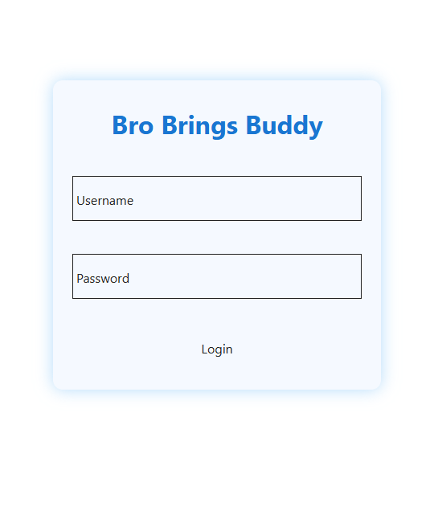
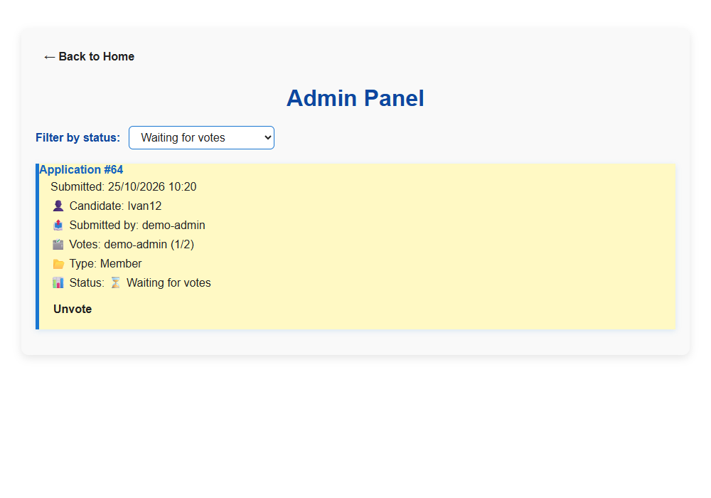

# Bro Brings Buddy — web client

Bro Brings Buddy is a web app for submitting and reviewing membership and administrator applications. Members can track their submissions, vote on applications addressed to them, and use the Buddy Clicker mini-game. Administrators can review all applications and manage their status.





## Tech stack

- Angular 19 and TypeScript
- Angular Material and SCSS
- RxJS
- Karma and Jasmine for tests

## Run locally

Requirements: Node.js and npm, plus the [bbb-server](https://github.com/Sell6ix/bbb-server) API running at `http://localhost:3000`.

```bash
npm ci
npm start
```

Open `http://localhost:4200`. The development server proxies API requests to `http://localhost:3000` using `proxy.conf.json`.

## Build and test

```bash
npm run build
npm test
```
